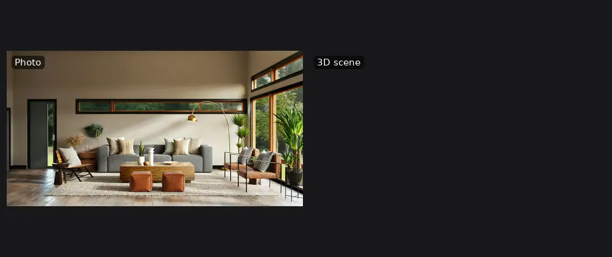
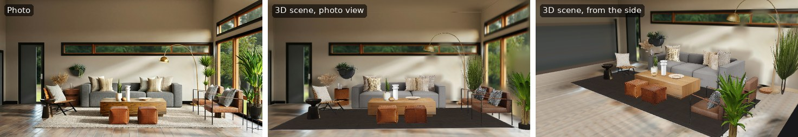
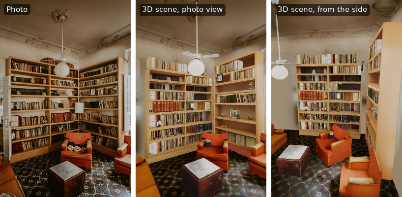

# WorldBuilder

**One photo of a room in, an editable 3D scene out.** Runs on your own GPU and exports to the
browser (WebXR), Blender, MuJoCo and anything that reads glTF.

[](https://github.com/AdamRolander/WorldBuilder/actions/workflows/ci.yml)
[](https://github.com/AdamRolander/WorldBuilder/releases)
[](LICENSE)


<p align="center">
  
</p>
<p align="center"><sub>Each photo next to the scene WorldBuilder built from it. Every object pops in on its own
because it is its own mesh; the largest are switched off and on again. Shown after a few
fixes in the browser viewer. Photos from Spacejoy and Jonathan Borba on <a href="https://unsplash.com">Unsplash</a>.</sub></p>

## What It Does

Give WorldBuilder a single ordinary photo of an indoor space. It finds the furniture and
objects in it, builds a 3D model of each one, works out where the floor, walls and ceiling are,
and puts everything back where it was in the photo. The result is a scene you can walk through
in a browser or a VR headset, rearrange, or load into a simulator.

- **Separate, named objects.** Each chair, table or lamp is its own textured mesh, not one
  fused surface, so it can be moved, removed or given physics.
- **A room around them.** Floor, walls and ceiling are fitted to the photo and textured from
  it, with the hidden parts filled in.
- **Fully local.** The models run on your own NVIDIA GPU. A cloud detector (Gemini) is
  optional.
- **Made to be used elsewhere.** Blender add-on, MuJoCo export for robotics, a lightweight
  GLB for game engines, and a browser viewer for review and quick fixes.

Under the hood it chains open models: a vision-language model (Qwen3-VL or Gemini) lists the
objects, [SAM 3](https://github.com/facebookresearch/sam3) segments every instance,
[SAM 3D Objects](https://github.com/facebookresearch/sam-3d-objects) turns each mask into a mesh,
and [MoGe](https://github.com/microsoft/MoGe) gives a point map of the whole scene. WorldBuilder's
own code is what happens after that: room layout, placement with physical support, room
textures and exports.

## Examples

| Photo, the scene from the photo's viewpoint, and from the side |
| --- |
|  |
|  |

More examples are coming. To make your own animation or stills from a scene:
`python scripts/make_hero.py --scene outputs/<scene> photo.jpg --out hero.webp --stills <folder>`.

## Documentation

| Guide | What's in it |
| --- | --- |
| [Setup](docs/SETUP.md) | Requirements, installing both environments, downloading the models, first run |
| [Usage](docs/USAGE.md) | The CLI, the web app, reviewing and editing scenes in the viewer, output files |
| [Plugins](docs/plugins/README.md) | [Blender](docs/plugins/BLENDER.md), [MuJoCo](docs/plugins/MUJOCO.md), [Unreal](docs/plugins/UNREAL.md), and where plugins are going next |
| [Architecture](docs/ARCHITECTURE.md) | How the pipeline works stage by stage, file formats, coordinate frames, repo layout |
| [Hardware](docs/HARDWARE.md) | Measured GPU memory and time per stage, which cards work, what runs without a GPU |
| [Benchmarks](docs/BENCHMARKS.md) | How quality, speed and memory are measured and how two runs are compared |
| [Troubleshooting](docs/TROUBLESHOOTING.md) | Common setup and runtime errors |
| [Contributing](CONTRIBUTING.md) | How to help, development setup, ground rules |
| [Changelog](CHANGELOG.md) | What changed in each release |

## How It Works

```
photo ─▶ 1 detect ─────▶ 2 segment ─────▶ 3 reconstruct ─────▶ 4 assemble ─────────────▶ viewer.html
         Qwen3-VL or      SAM 3: a mask      SAM 3D Objects:      layout, placement,         scene_lite.glb
         Gemini: what     per instance,      a mesh and pose      room textures, exports      Blender, MuJoCo
         objects are      plus floor, wall,  per mask; one MoGe   (CPU only, replayable)
         in the photo     ceiling, window    point map per scene
```

1. **Detect.** A vision-language model lists the kinds of objects worth reconstructing, with a
   short description and an expected count for each.
2. **Segment.** SAM 3 turns each label into one mask per instance, and also segments the
   floor, walls, ceiling and windows.
3. **Reconstruct.** SAM 3D Objects lifts each mask into a textured mesh with a pose. The scene
   point map is computed once and shared by every object.
4. **Assemble.** WorldBuilder fits the floor, gravity and walls to the point map; places each
   object so its silhouette matches the photo and it rests on something (floor, a table, a
   wall); shares one good mesh between repeated objects such as a row of chairs; textures the
   room from the photo; and writes the viewer, the GLBs and optional MuJoCo files.

Stage 4 needs no GPU and can be replayed in seconds from what stage 3 leaves on disk, which is
where most development happens. Details: [Architecture](docs/ARCHITECTURE.md).

## Quick Start

You need Linux, an NVIDIA GPU with 24 GB or more (developed on an RTX 5090; 24 GB cards
should work but haven't been tested), about 60 GB of disk, conda, and a Hugging Face account
with access to the two gated SAM checkpoints. Request
[SAM 3](https://huggingface.co/facebook/sam3) and
[SAM 3D Objects](https://huggingface.co/facebook/sam-3d-objects) access first; approval can
take a day.

The install takes one to two hours, mostly downloads. In outline:

```bash
git clone https://github.com/AdamRolander/WorldBuilder.git && cd WorldBuilder
git clone https://github.com/facebookresearch/sam3.git            sam3_repo
git clone https://github.com/facebookresearch/sam-3d-objects.git  sam3d_objects_repo
git clone https://github.com/facebookresearch/pytorch3d.git       pytorch3d
# create the worldbuilder-main (and optionally worldbuilder-vlm) conda envs,
# then download the checkpoints: see docs/SETUP.md for the exact commands
```

Then:

```bash
conda activate worldbuilder-main
python main.py --image my_room.jpg --detector gemini     # or --detector qwen, fully local
python -m http.server -d outputs/my_room_g 8000          # open http://localhost:8000/viewer.html
```

A photo takes about seven minutes on an RTX 5090, most of it in SAM 3D (a few seconds per
object). Prefer a browser UI? `python -m webapp.server` serves an upload page at
`http://localhost:5174`. The full walkthrough is in [Setup](docs/SETUP.md) and
[Usage](docs/USAGE.md).

**No GPU?** Placement, the room, the viewer and every exporter run on a CPU, and the test
suite needs no models. See [CPU-Only Development](docs/SETUP.md#cpu-only-development).

## Plugins

| | |
| --- | --- |
| **Blender** 4.2+ | Generate or import a scene from the sidebar; every object arrives as a named, textured mesh. [Guide](docs/plugins/BLENDER.md) |
| **MuJoCo / MJX** | A metric, Z-up model with collision geometry and free joints on movable objects, plus a Gymnasium wrapper to put a robot in the room. [Guide](docs/plugins/MUJOCO.md) |
| **Unreal Engine** 5.4+ | Early scaffold, not yet tested. [Guide](docs/plugins/UNREAL.md) |
| **Everything else** | `scene_lite.glb` (7-30 MB, baked textures) opens in Godot, Unity, three.js and most 3D tools |

Plugins are thin clients of a server you run; the models never leave it. Planned targets
(Godot, Isaac Sim, Unity, USD, ROS 2 and more) are listed in [Plugins](docs/plugins/README.md#where-wed-like-plugins-next).

## Limitations

WorldBuilder is alpha software. Things to know before relying on it:

- **The back of every object is invented.** SAM 3D completes what the photo didn't show; it
  is plausible, not measured. The same goes for walls the photo didn't see.
- **Scale is an estimate.** A single photo has no absolute scale. With the optional MoGe-2
  step it is measured by a metric depth model; otherwise it assumes a typical camera height.
- **Detection varies.** The object list comes from a vision-language model and can miss things
  or differ between runs.
- **Glass and mirrors** are handled poorly; **outdoor scenes** are early.
- **It needs a big GPU.** 24 GB is the minimum; the models are run one at a time to fit.

## Project Status

Under active development. Releases and their changes are in the [Changelog](CHANGELOG.md);
plans and known problems are in the [issue tracker](https://github.com/AdamRolander/WorldBuilder/issues).
Bug reports with a photo are the most useful thing you can send.

## Contributing

Contributions are welcome, and much of the work (placement, textures, viewer, exporters,
plugins, docs) needs no GPU. Start with [Contributing](CONTRIBUTING.md) and issues labelled
`good first issue` or `no-gpu`.

## Citing

If you use WorldBuilder in research, please cite it using the metadata in
[CITATION.cff](CITATION.cff) (GitHub's **Cite this repository** button gives BibTeX and APA).
A software paper is in preparation.

## License and Acknowledgements

WorldBuilder's code is MIT licensed (see [LICENSE](LICENSE)), except the Blender add-on in
`integrations/blender_worldbuilder/`, which is GPL-3.0-or-later as Blender's extension
platform requires (see [its licence](integrations/blender_worldbuilder/LICENSE)). It runs on models and code that
you obtain separately under their own terms and that this project never redistributes:
SAM 3 and SAM 3D Objects (Meta, SAM License), MoGe (MIT), PyTorch3D (BSD), Qwen3-VL
(Apache-2.0). Thanks to their authors for releasing them.
